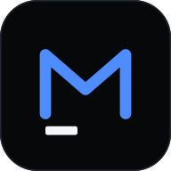

# MyMailbox

MyMailbox is a personal webmail for your own domain: email and calendar running entirely on your Cloudflare account, with Cloudflare Workers for the app, D1 for the data and R2 for raw mail, attachments and backups. You own the mailboxes, the data and the deployment. A Gmail-like three-pane interface, per-project sending identities, labels and fuller Gmail-style search are in progress.

## Features

### Mail

- **Mailboxes on your domains**: personal or shared mailboxes with access you control, aliases and catch-all addresses. Receive through Cloudflare Email Routing or Resend and send through Cloudflare Email Sending or Resend, chosen per domain.
- **Reading and writing**: conversation view, rich-text composer with signatures and templates, undo send, scheduled send, snooze, follow-up reminders, opt-in read receipts, auto-replies and conversation notes.
- **Organising**: Gmail-style labels (many per message, never taking mail out of the inbox), stars, archive, routing rules (label, skip the inbox, forward or reject incoming mail) and an optional Promotions category for bulk mail.
- **Search**: Gmail-style search across every folder: full text, exact phrases, `OR`, `-exclusions` and parentheses, plus `from:`, `to:`, `cc:`, `bcc:`, `subject:`, `label:`, `project:`, `in:`, `is:`, `has:attachment`, `filename:`, `after:`/`before:`, `newer_than:`/`older_than:`, `larger:`/`smaller:` and `deliveredto:`. The `?` in the search box lists them.
- **Spam filtering**: local scoring from authentication results, sender history, a Bayesian classifier and optional blocklist lookups. See [Spam protection](docs/spam-protection.md).
- **Deliverability**: per-domain suppression of bounced addresses, DMARC aggregate and TLS reports, MTA-STS. See [Deliverability](docs/deliverability.md).

### Calendar

- Repeating events with time zones and reminders.
- Invitations emailed to attendees from your mailbox, with RSVP tracking; invitations you receive are added to your calendar.
- A private calendar feed (`.ics`) to subscribe to from other apps.

### Platform

- **Accounts**: passwords, TOTP two-factor authentication, passkeys and password reset by email.
- **Notifications**: Web Push and an installable web app with an offline page.
- **Integrations**: scoped API keys, webhooks with retries and a [JMAP](https://jmap.io) server for external mail apps. See [API and integrations](docs/api.md).
- **Admin**: users, domains, audit logs, scheduled backups to R2, database migrations from the admin page and your own app name and icon.
- **Export**: download a mailbox as an `.mbox` file.
- **Languages**: English and Português (Brasil).

## Cost

- **Cloudflare**: the Workers Paid plan ($5/month) is recommended. The free plan's CPU time is tight for parsing and filtering mail, and Cloudflare's own Email Sending needs the paid plan. Receiving through Cloudflare Email Routing is free.
- **Sending through Resend**: the free tier (3,000 emails a month at the time of writing) is enough for personal mail.

Prices change, so check [Cloudflare](https://developers.cloudflare.com/workers/platform/pricing/) and [Resend](https://resend.com/pricing).

## Deploy

You need a Cloudflare account whose DNS hosts the domain you want to use, and Node 24.

1. **Create the runtime token.** `CF_TOKEN` is a scoped Cloudflare API token that the app uses at runtime to manage DNS and Email Routing. The permissions are listed in the [deployment guide](docs/deployment.md#step-1-create-cf_token).
2. **Create the queues and deploy.** `wrangler.jsonc` names the Worker `mymailbox`, the D1 database `mymailbox`, the R2 bucket `mymailbox-raw` and the queues `mymailbox-inbound` and `mymailbox-outbound`.

   ```bash
   npm install
   npx wrangler login
   npx wrangler queues create mymailbox-inbound
   npx wrangler queues create mymailbox-outbound
   npm run deploy
   npx wrangler secret put CF_TOKEN
   openssl rand -base64 32          # copy this value: /setup asks for it
   npx wrangler secret put SETUP_TOKEN
   ```

   On the first deploy, Wrangler provisions the D1 database and the R2 bucket named in `wrangler.jsonc`. `SETUP_TOKEN` is a secret only you know: `/setup` asks for it before it touches the database or DNS, and refuses to run until it is set.
3. **Set `APP_URL`.** Add it as a variable on the Worker (Settings, Variables and Secrets) with the app's public HTTPS address, for example `https://mail.example.com`. Receiving through Resend and read receipts use it.
4. **Finish setup.** Open the app at `/setup` and enter the setup token. It checks the Cloudflare configuration, initializes the D1 database and creates your admin account.
5. **Connect a domain.** Add a domain from the same Cloudflare account, then create your first mailbox.

More options, including deploying with an AI coding agent: [deployment guide](docs/deployment.md).

## Local development

```bash
nvm use                       # Node 24, from .nvmrc
npm install
cp .dev.vars.example .dev.vars
npm run db:migrate:local
npm run dev
```

Add your Cloudflare credentials to `.dev.vars`, then open [localhost:3000](http://localhost:3000). Run `npm run db:seed` to load sample data. On `localhost` and `127.0.0.1`, setup runs without a `SETUP_TOKEN`; any other development host name needs one in `.dev.vars`.

Before committing, run the checks:

```bash
npm run db:bundle             # refresh the migration bundle
npx tsc --noEmit              # type check (the build does not)
npm run lint
node --test tests/*.test.mjs
npm run build
```

A schema change needs a migration. See [Database](docs/databases.md#migrations).

## Documentation

- [Deployment and configuration](docs/deployment.md)
- [Database](docs/databases.md)
- [Sending and receiving providers](docs/providers.md)
- [API and integrations](docs/api.md)
- [Adding a language](docs/localization.md)
- [Troubleshooting](docs/troubleshooting.md)

## Fork notice

MyMailbox is a modified version of [Mailflare](https://github.com/hieunc229/mailflare) by Hieu Nguyen, licensed under the GNU Affero General Public License v3.0. It forked from Mailflare 0.5.5 and is developed separately. The main modifications:

- Removed Drive, public booking pages, the AI assistant and MCP server, the license system, the Node and Docker runtime, databases other than D1, Amazon SES and S3/Backblaze B2 storage, the mail, contacts and calendar import tools, native push and device login, CalDAV and CardDAV, and 32 of the 34 interface languages (English and Português (Brasil) remain).
- Squashed the database migrations into a D1 baseline.
- Applied a new visual identity and the MyMailbox name.
- The v1 features listed above as in progress, as they land.

The source code of MyMailbox is available at https://github.com/MatheusVMariussi/MyMailbox.

## License

MyMailbox is licensed under the GNU Affero General Public License v3.0, like Mailflare. See [LICENSE](LICENSE), which keeps the upstream copyright notice.
