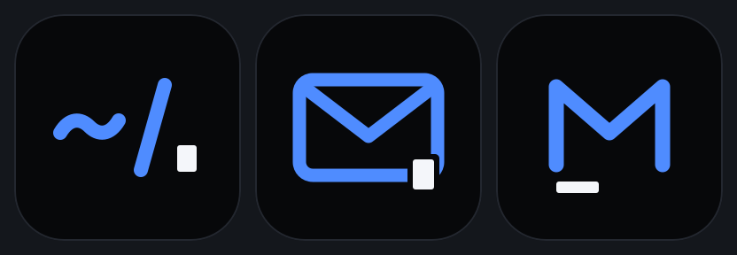

# MyMailbox brand

MyMailbox extends the `~/matheus` identity from matheusmariussi.com: near-black layered surfaces, one
interaction accent (blue `#4f8cff`) and three semantic accents (live `#34d399`, category `#c084fc`,
warm `#fbbf24`), Inter for reading, Space Grotesk for headings and JetBrains Mono for terminal accents.
The tokens live in `src/app/globals.css`.

## Marks

| File | Idea |
| --- | --- |
| `mark-c-monogram.svg` (in use) | An "M" whose middle is an envelope flap, with a terminal cursor under it |
| `mark-a-prompt.svg` | The `~/` prompt with a block cursor, closest to the portfolio wordmark |
| `mark-b-envelope.svg` | An envelope with a block cursor on its corner, the most literal "mail" read |

`mark-c-maskable.svg` is the full-bleed variant for Android's maskable icon (artwork inside the 80% safe zone).

To switch marks, render the chosen SVG to `public/icon-{48,96,192,512}.png`, `public/icon-maskable-512.png`
(full-bleed variant), `public/apple-touch-icon.png` (180 px, no transparency), `public/favicon.ico`
(16/32/48) and copy it to `public/icon.svg`.
